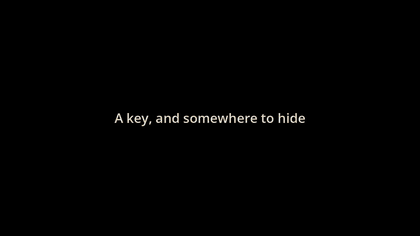

# The Waking Dark

First-person survival horror in Godot 4.7 (GDScript). This repo holds **Act 1**: the west
wing of Ashgrove Manor under the pale moon, built to answer one question: is hiding from
spirits in the dark with a dying flashlight actually scary?



**[Watch the gameplay clip (44 s, mp4)](docs/gameplay.mp4)**: waking up, the servants' hall,
taking a key off its hook, hiding in a wardrobe (you look out through the slats), the bright
beam driving off a spirit, and a few silent seconds of Jason and Daniel meeting in a
candle-lit room. It is the real game (see [Gameplay video](#gameplay-video) for how it is
made). The clip stops before anyone speaks; the story is left for you to find.

## Play the demo

- **In the editor:** open `project.godot` in Godot 4.7.2 and press F5.
- **macOS build:** `builds/macos/The Waking Dark.app`. It's ad-hoc signed, so on another
  Mac you have to right-click it and choose Open the first time.
- **Windows build:** `builds/windows/TheWakingDark.exe`. It's a single file. SmartScreen
  will warn because it's unsigned: click "More info", then "Run anyway".

(The builds are made from a release export; re-export after changing the game, see
[Test and export](#test-and-export).)

**Goal:** you wake in a ruined manor with a head wound, no memory and nothing to see by.
Find a light, find out what happened, and find a way through the west wing. Spirits patrol
the house and you can't fight them: hide, stay quiet, and spend your light wisely. If one
catches you in the dark, you lose (with a retry from the last checkpoint). Locked doors,
hidden keys and a few hard choices stand in the way; there is a lot to find.

**Hiding:** inside a wardrobe you look out through the gap between the doors and the slats,
and a faint light seeps in so it is never pitch black. You can switch the flashlight on in
there, but a spirit close by will see the light and come for you.

| Key | Action |
|---|---|
| WASD | Move |
| Shift | Sprint (limited stamina) |
| C / Ctrl | Crouch (quieter, harder to see) |
| E | Interact / hide / step out |
| F | Flashlight on/off |
| Right mouse / Space (hold) | Bright beam: drains fast, weakens the spirit and drives it off |
| Esc | Free the mouse |
| F3 | Debug readout (battery, exposure, spirit state) |
| F11 | Fullscreen |

## How the systems fit together

- **Flashlight** (`scripts/flashlight.gd`): normal and bright modes, battery drain, and a
  faint glow at 0% so the screen never goes fully black.
- **Darkness exposure** (also in `flashlight.gd`): builds while you're unlit. At 15 s the
  spirit senses roughly where you are; at 30 s it hunts you. It decays in light or while
  hidden.
- **Lit areas**: the moonlit abandoned room, firelight and the candle pockets. The
  spirit won't enter them and can't catch you inside them.
- **Spirit** (`scripts/spirit.gd`): patrol, investigate, chase, search, retreat. It senses
  by sight, by noise, and through the darkness channel. It is a physical demon: doors block
  its sight and its body, but it shoves unlocked doors open. If it sees you climb into a
  wardrobe, it pulls you out. How it reacts to light and to you:
  - **Notice beat:** when it first sees you it freezes for 0.7 s, snaps its head round and
    opens its jaw, and shrieks, before it runs.
  - **Head tracking:** its head follows what it is watching: you in a chase, a noise, the
    hiding spot it is checking, or the way ahead.
  - **Bright beam:** a hiss and a short shriek, a push back, burning static that grows while
    the beam holds, then it breaks (a thud and a rush of smoke), flees in a pained,
    stumbling run, and comes back weaker. It never dies.
  - **Lit areas:** it stops at the edge, turns its face away and hisses; on patrol it
    picks another route after a moment.
  - **Catch:** a 1.3 s beat (your view swings to its face, arms up, jaw wide, a shriek)
    before the run ends.
  - **Footsteps** are fired by the walk animation itself, so they stay in step with the legs.
- **Noise** (`scripts/player.gd`): each footstep emits a radius of 1.5 m crouched,
  6 m walking or 12 m sprinting. Rattling a locked door is loud too.
- **Level** (`scripts/level.gd`): the rooms are built in code, with an ASCII map at the top
  of the file. Each spirit patrols its own zone (hall, foyer, library). Locked doors are
  walls to the navmesh, and it rebakes when one is unlocked so spirits can follow you.
- **Furniture** (`scripts/furnishing.gd`): hand-built tables, desks, counters, a stove,
  windows with curtains, candles and bookcase books, plus Poly Haven models for the rest
  (`scripts/props.gd`).
- **Key graph** (`tools/validate_keys.tscn`): checks the plan's rule that no key is locked
  behind its own door and that every door can be reached. The smoke test runs it too.
- **Memory fragments** (`data/memory_fragments.json`): the flashback text and the cutscene
  scripts, editable without touching code.

## Tuning

Every starting value from the plan is an `@export` variable. Select the Player,
Flashlight or Spirit in `scenes/` and change it in the Inspector:

| Setting | Where | Now (plan's start value) |
|---|---|---|
| Battery life, normal / bright | Flashlight | 480 s / 30 s (300 / 20) |
| Flashlight start charge | Flashlight `battery` | 100% (plan: ~60%) |
| Battery pickups | Pickup `battery_amount` | 4 × +60% (plan: 4 × +35%) |
| Walk / sprint, stamina, refill | Player | 2.5 / 4.8 m/s, 8 s, 5 s (2.5 / 4.5, 5 s) |
| Spirit patrol / chase | Spirit | 1.2 / 2.6 m/s (1.5 / 3.2) |
| Spirit notices you after / sight range | Spirit | 0.9 s (+0.7 s notice beat) / 8 m (4 m crouched) |
| Bright beam to weaken, retreat | Spirit | 0.8 s, 10 s (1.5 s, 6 s) |
| Exposure sense / hunt | Flashlight | 15 s / 30 s (8 / 15); only spirits within 18 m hunt |
| Noise, crouch / walk / sprint | Player | 1.5 / 4 / 9 m |

**Checkpoints:** picking up a key item or unlocking a door saves progress ("Progress
saved" bottom right). When you're caught, **Retry from checkpoint** restores your position,
items and doors. Each death since the last checkpoint gives back more battery (at least 55%,
then 70%, ...). Spirits that would start right next to you are moved away. Checkpoints live
in memory for now; the plan's JSON saves come later.

Each run appends a line to `playtest_log.csv` in Godot's user folder
(`~/Library/Application Support/Godot/app_userdata/The Waking Dark/` on macOS). It
records the result, the time taken and the battery at death, which is the number the
plan says to track.

## Test and export

```sh
GODOT=~/Applications/Godot.app/Contents/MacOS/Godot

# Headless smoke test: drives every system and plays Act 1 start to finish (~90 checks)
$GODOT --headless --path . res://tests/smoke_test.tscn

# Key graph check (exits non-zero if a key is locked behind its own door)
$GODOT --headless --path . res://tools/validate_keys.tscn

# Top-down map render of the level (opens a window)
$GODOT --path . res://tools/map_preview.tscn -- /tmp/map.png

# Builds
$GODOT --headless --path . --export-release "macOS"   builds/macos/TheWakingDark.zip
$GODOT --headless --path . --export-release "Windows" builds/windows/TheWakingDark.exe
```

The smoke test also checks that no gesture pushes a forearm or hand into the body or head,
that gestures move smoothly, and that every recorded sound set loads. It runs headless
with Godot's dummy audio driver, which is why it ends with an "ObjectDB instances were
leaked at exit" warning; a normal windowed run does not show it.

The preview tools open a window, so don't cover it while they render:

```sh
$GODOT --path . res://tools/monster_preview.tscn -- /tmp/shots   # the spirit's poses
$GODOT --path . res://tools/daniel_preview.tscn -- /tmp/shots    # the characters' gestures
$GODOT --path . res://tools/cutscene_shots.tscn -- /tmp/cuts     # every line of the cutscenes
$GODOT --path . res://tools/scene_shots.tscn -- /tmp/views       # a few views of the level
```

## Gameplay video

`docs/gameplay.mp4` (and the short preview `docs/gameplay.gif`) are recorded from the real
game by `tools/record_demo.gd`: it plays the real controls, fades between scenes, and keeps
the spirits from catching Jason. It uses Godot's movie writer, so it needs a window:

```sh
$GODOT --path . res://tools/record_demo.tscn --write-movie /tmp/demo.avi --fixed-fps 30 --resolution 1280x720

# Encode (needs ffmpeg): a small mp4, then a short looping gif of four highlights
ffmpeg -i /tmp/demo.avi -c:v h264_videotoolbox -b:v 1100k -maxrate 1600k -bufsize 3200k \
  -pix_fmt yuv420p -c:a aac -b:a 96k -movflags +faststart docs/gameplay.mp4
ffmpeg -i /tmp/demo.avi -filter_complex \
  "[0:v]split=4[a][b][c][d];[a]trim=16:19.5,setpts=PTS-STARTPTS[v1];[b]trim=21:25,setpts=PTS-STARTPTS[v2];[c]trim=29.3:33,setpts=PTS-STARTPTS[v3];[d]trim=40:43,setpts=PTS-STARTPTS[v4];[v1][v2][v3][v4]concat=n=4:v=1:a=0,fps=8,scale=420:-1:flags=lanczos,split[s0][s1];[s0]palettegen=max_colors=64:stats_mode=diff[p];[s1][p]paletteuse=dither=bayer:bayer_scale=5" \
  docs/gameplay.gif
```

(`h264_videotoolbox` is the macOS encoder; use `libx264 -crf 28` elsewhere.) The default reel
is spoiler-free (the opening, taking a key, hiding, the beam, and a silent, subtitle-free
glimpse of the meeting that stops before anyone speaks). Adding `-- --full` after the scene path records a longer
reel with the story cutscenes, which is for private use, not the README. Keep the raw AVI out
of the repo.

## The spirit's body

The spirit is a rigged, skinned model, `assets/monster/spirit.glb`. It was built in
Blender on an MPFB (MakeHuman) base: emaciated and long-armed, with a sculpted ribcage,
deep eye sockets, a jaw bone, and a painted wet grey skin. It is animated procedurally
by `scripts/monster_body.gd`, which writes each pose as "pivot" rotations (every limb
hanging straight down) and maps them onto the skeleton's bones. It stands upright with
straight legs (no leaning, knee bends or pelvis sway); its reactions are arm, head and
jaw poses, and a smoke and glow effect. The Blender source is kept with the character
files (`spirit/spirit.blend`, collection `MPFB_Spirit`).

The old signed-distance sculpt (`tools/bake_monster.gd`, the `.res` parts in
`assets/monster/`, `tools/head_preview.tscn`) is no longer used by the game.

## Audio

Recorded sounds (see `assets/CREDITS.md` for licences) live in `assets/audio/` and are
loaded by `scripts/sound_bank.gd` as numbered sets: footsteps per surface
(`steps/<surface>_NN.wav`; `level.gd` maps each room to wood, concrete, carpet, metal or
stairs), door creaks, the wind loop, and the spirit's voice (shriek, snarl, pained cry, weak
rasp and breathing). The spirit's voice is by VoiceBosch, **CC BY-SA 4.0: credit them**
(`assets/audio/spirit/LICENSE.txt`). Jason's heartbeat (faster as a spirit closes in) and
breathing (when winded, or hiding with a spirit near) are synthesised in
`scripts/audio_gen.gd`, as are the spirit's light reactions, the drone, the music layers and
the small effects.

## Look and characters

- **Environment art** (`scripts/level.gd`): wallpaper and floorboard textures with normal
  maps are generated at startup (`_wallpaper_texture`, `_plank_textures`). Walls get
  skirting, wainscot, chair rail and crown moulding (`_wall_trim`). Dust motes drift around
  the player. Fog, SSAO and glow are tuned in `scenes/main.tscn`.
- **Characters** (`scripts/character_rig.gd`): the two characters are Blender models in
  `assets/models/` (`daniel.glb`, `jason.glb`). They have no baked animations, so the rig
  poses them in code with IK on the arms and legs: relaxed arms, breathing, weight
  shifts, a walk cycle, head look-at and cutscene gestures (`talk`, `calm`, `startle`,
  `show_hand`, `point`, `touch_head`, `after_you`) and small props in the hands. Jason's
  body is attached to the player (`player.gd`), so you see your legs, hands and shadow in
  first person. His head is hidden in first person and only shows in cutscenes.
- **Cutscenes** (`scripts/cutscene_director.gd`): `"style": "scene"` fragments cut to a
  third-person camera with letterbox bars. Each line in `data/memory_fragments.json` can
  set `"shot"` (wide, daniel, jason, daniel_close, jason_close, jason_right, hand, moon,
  door, id), gestures (`"daniel"`, `"jason"`), `"at"` (a named point to point at) and
  `"approach"`. A fragment can be `"solo": true` (a scene with only Jason).

## Repo notes

- `.godot/` and `builds/` are git-ignored.
- `.gitattributes` routes images, audio, `.glb` and `.blend` files through Git LFS.
  Install it before adding art (`brew install git-lfs && git lfs install`). The
  `docs/` video and gif are plain files (about 9 MB together).
- Credits and licences for every outside asset are in `assets/CREDITS.md`.
- Not yet playtested by a person: spirit difficulty, battery pacing and the cutscene
  camera shots are untuned.
